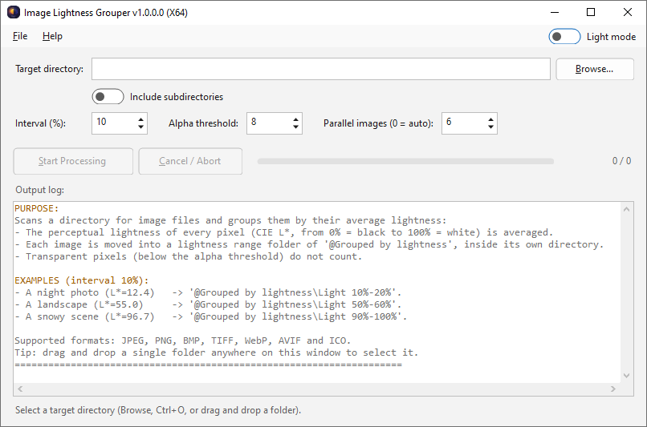
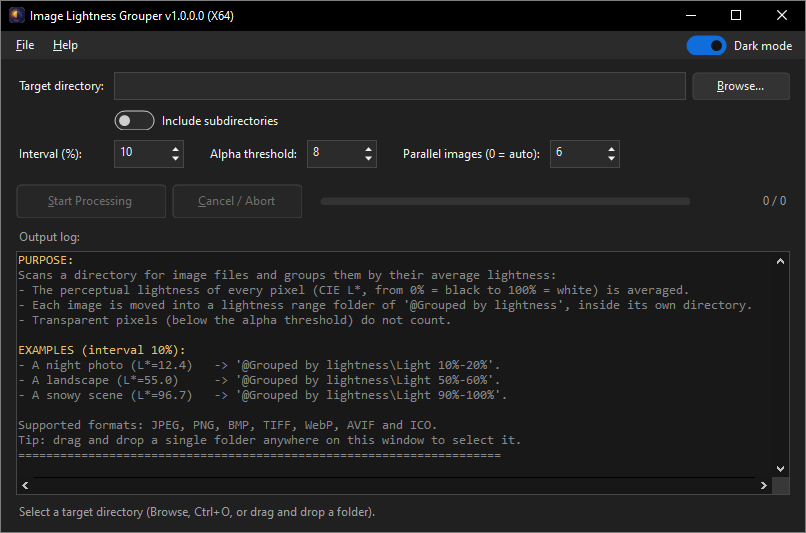

<!-- Common Project Tags:
bitmap
classification
desktop-app
desktop-application
dotnet
file-organizer
image-processing
images
lightness
luminance
cie-lab
netframework
netframework48
organizer
tool
tools
vbnet
visualstudio
wallpapers
webp
windows
windows-app
windows-application
windows-applications
windows-forms
winforms
 -->

  
  
  <h1>Image Lightness Grouper</h1>

### A desktop tool to group image files into folders by their perceived lightness.

------------------

    &nbsp;
    &nbsp;
    &nbsp;
    
    &nbsp;
    
   
   
    
    
    
    
    
    
   
    
    
    
    
    
    
   
   
    

------------------

## 👋 Introduction

**Image Lightness Grouper** is a desktop utility that scans a folder of images (optionally including all its subfolders) and groups every image into a folder according to its average lightness, measured in the perceptually accurate **CIE L\* color space** (from 0% = black to 100% = white).

Each image is moved into `@Grouped by lightness\Light XX%-YY%`, inside its own folder. With the default 10% interval, the folders are `Light 00%-10%`, `Light 10%-20%` ... `Light 90%-100%`; a night photo ends up in `Light 10%-20%`, a landscape in `Light 50%-60%` and a snowy scene in `Light 90%-100%`.

This is the desktop (Windows Forms) successor of the **[Image Lightness Organizer](https://github.com/ElektroStudios/Image-Lightness-Organizer)** command-line tool.

## 💡 Motivation

When working with large collections of graphic assets, datasets for machine learning, or wallpaper libraries, sorting images by their visual weight and luminance manually is nearly impossible. Standard file managers only allow sorting by name, date, or dimensions, leaving no native option to group files by how bright or dark they actually appear to the human eye.

Furthermore, standard RGB math fails to reflect true human perception. I built this tool to solve this problem using the CIE L\* color space, providing an automated way to cluster image assets into precise percentage brackets, now with a friendly graphical interface.

##### ⚡ The Real Question
###### How much time do you lose manually hunting for light or dark backgrounds, assets, or textures across disorganized folders when a perceptually accurate algorithm can catalog them for you in seconds?.

## 🖼️ Screenshots

  &nbsp;

## 🎦 Videos

<!-- Download a recorded video by clicking [here](/Video/video.mp4) -->

<!-- See a recorded video by clicking on the following button:
  -->

## ✨ Features

- Perceptually accurate lightness (CIE L\*), computed from every pixel of the image.
- Supported formats: JPEG, PNG, BMP, TIFF, WebP, AVIF and ICO.
- Configurable lightness interval (1% to 10%) and alpha threshold (transparent pixels can be ignored).
- Optional search in all subdirectories: every folder gets its own output folder, so images of different folders are never mixed.
- Fast, multi-threaded processing, with an automatic degree of parallelism based on the free memory (or a custom value), that can be cancelled at any time.
- Real-time output log, and a progress bar that reports the final result (errors or warnings).
- Safe to run again over an already grouped folder: the output folders and the lightness range folders (even if you rename the output folder) are never scanned again, and existing files are never overwritten.
- Dark and light themes.
- Drag and drop a folder onto the window to select it.
- Remembers your preferences between sessions.

## 📝 Requirements

- Microsoft Windows OS.
- .NET Framework 4.8 (already included in Windows 10 version 1903 and newer).

## 🚀 Getting Started

1. Navigate to the **[Releases page](https://github.com/ElektroStudios/Image-Lightness-Grouper/releases/latest)**.
2. Download the latest `.zip` archive or the `.exe` setup installer, depending on your preference.
3. If you downloaded the `.zip` archive, extract its contents to your preferred directory.
     
   If you downloaded the `.exe` file, run it and follow the installation wizard.
4. Run the executable file to launch the application.

## 🔄 Change Log

Explore the complete list of changes, bug fixes, and improvements across different releases by clicking [here](/Docs/CHANGELOG.md).

------------------

## 💪 Contributing

Your contribution is highly appreciated!. If you have any ideas, suggestions, or encounter issues, feel free to open an issue by clicking [here](https://github.com/ElektroStudios/Image-Lightness-Grouper/issues/new/choose). 

Your input helps make this Work better for everyone. Thank you for your support! 🚀

## 💰 Beyond Contribution

This work is distributed for educational purposes and without any profit motive. However, if you find value in my efforts and wish to support and motivate my ongoing work, you may consider contributing financially through the following options:

| Platform | How to Support |
| :---: | :--- |
|  | **[Become my sponsor on GitHub](https://github.com/sponsors/ElektroStudios/)** Contribute any amount you prefer and unlock rewards! |
|  | **[Support me on Ko-fi](https://ko-fi.com/elektrostudios)** Buy me a coffee! |
|  | **[Become a Patron on Patreon](https://www.patreon.com/c/elektrostudios/membership)** Support my open-source work regularly! |
|  | **[Make a PayPal Donation](https://www.paypal.com/cgi-bin/webscr?cmd=_s-xclick&hosted_button_id=E4RQEV6YF5NZY)** Donate any amount you like via PayPal! |
|  | **[Purchase my software at Envato's CodeCanyon](https://codecanyon.net/item/elektrokit-class-library-for-net/19260282)** Discover my desktop tools and **DevCase Class Library for .NET**, an extensive API suite. |

 

  <b>Your support means the world to me! Thank you for considering it! 🤗💗</b>

------------------

## 🏆 Credits

This work relies on the following technologies and libraries: 

 - [.NET Framework](https://dotnet.microsoft.com/en-us/download/dotnet-framework)
 - [Ookii.Dialogs.WinForms](https://github.com/ookii-dialogs/ookii-dialogs-winforms)
 - [SkiaSharp](https://github.com/mono/SkiaSharp)

## ⚠️ Disclaimer

This software and its associated repository are provided strictly on an "as is" basis, without warranties of any kind, whether express or implied. This includes, but is not limited to, any implied warranties of merchantability, reliability, or fitness for a particular purpose.

The authors and copyright holders assume no liability for any direct, indirect, incidental, or consequential damages—including data loss or system errors—arising from the use, misuse, or inability to use this software. You are solely responsible for determining the appropriateness of using this tool and assume all associated risks.

Furthermore, this project operates entirely independently. The utilization of any third-party libraries or components within this software does not imply any affiliation with, or endorsement or approval by, their respective original authors.

This software may interact with third-party services, websites, or platforms. It is the user's sole responsibility to ensure that such use complies with the applicable terms of service, laws, and regulations. The authors do not endorse, and are not responsible for, any misuse of this software to violate third-party terms of service or applicable law.

By using this software, you agree to indemnify and hold harmless the authors from any claims, damages, or liabilities arising from your use or misuse of it.

This project is licensed under the **Apache License, Version 2.0**. See the  [License](./LICENSE) file for details.
